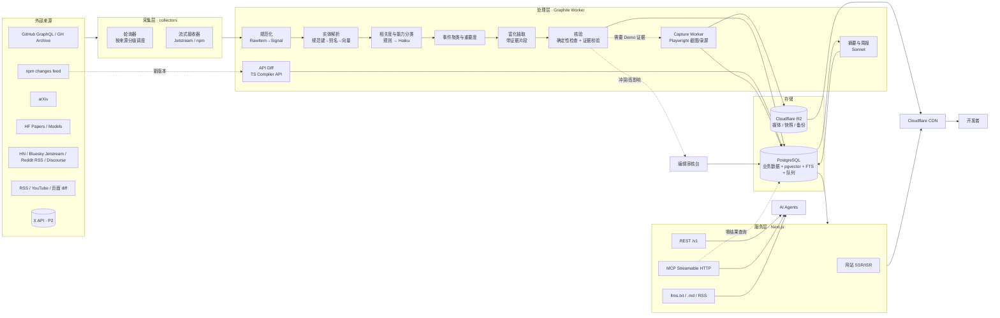
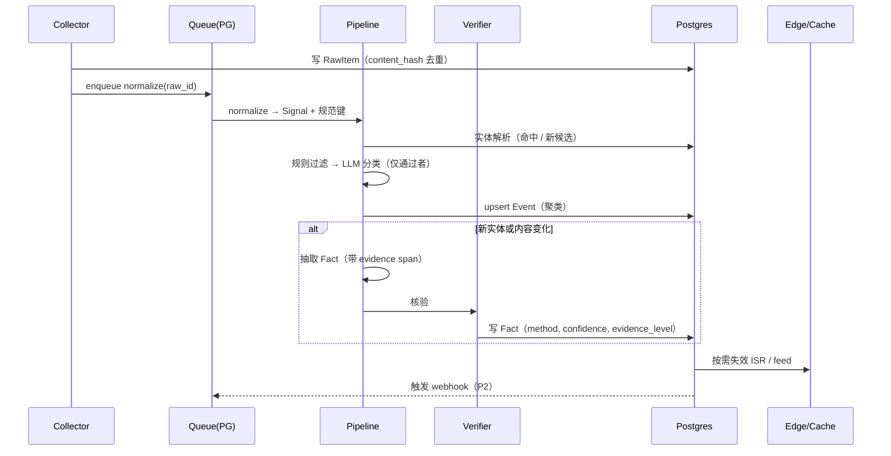
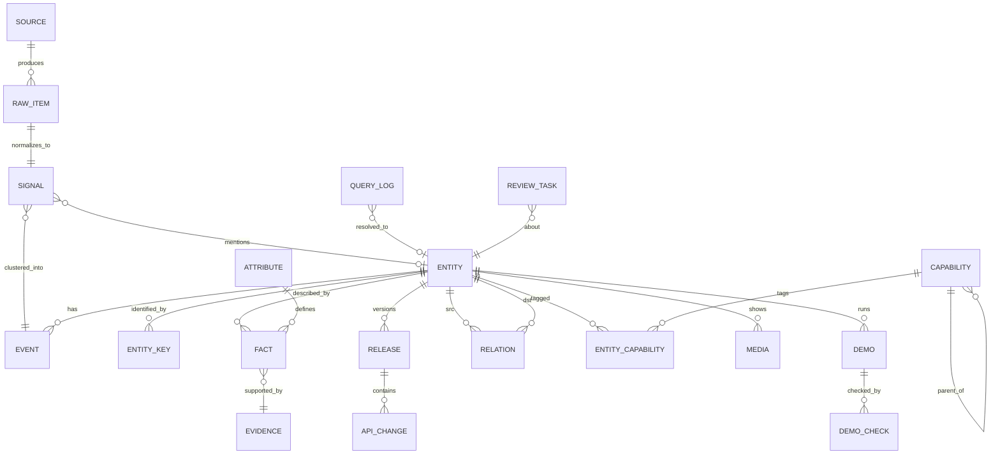

# Polyradar 产品与架构方案 v1

> 代号 Polyradar（暂定）。日期 2026-10-30。本文是开发的唯一依据；与本文冲突的实现，先改本文再改代码。

---

## 0. 一页结论

**不做"又一个 AI 新闻聚合站"。** 抢首发我们赢不了 X、HN 和 newsletter，做目录赢不了 There's An AI For That 这类站，做文档检索赢不了 Context7 和 DeepWiki。

**要做的：Web 原生实时 3D 与 AI 游戏创作领域的「可核验技术状态库」。** 它在任意时刻回答三个问题，人和 Agent 都能用：

1. **现在什么是真的**：某库当前版本里哪个 API 还在、改名成了什么、该怎么迁移（例：`three@0.18x` 下 TSL 写法）。
2. **做 X 现在该用什么**：例如「图片转可绑骨 GLB 并在 three.js 里跑」，有哪些可选方案，每个的许可、产出格式、是否支持浏览器/WebGPU、证据等级。
3. **最近变了什么，跟我有没有关系**：带 diff 的变化流，不是文章流。

**核心对象是「实体 + 带证据的事实 + 版本时间线」，不是「文章」。** 新闻只是触发事实更新的信号。

**首要用户是写 Web 3D/游戏代码的 AI 编码 Agent（Claude Code、Cursor、Codex 等）以及背后的开发者。** 人类网站是"证据展示面"：截图、视频、可点的 Demo、对比表。

三个关键取舍：

| 取舍 | 选择 | 放弃 |
|---|---|---|
| 范围 | Web 原生运行时 + 能落到 Web 的 AI 资产/创作流程 | Unity/Unreal 专属内容、通用 LLM 新闻、Web3/元宇宙 |
| 时效 | 只有"会改变代码正确性或选型"的变化追求分钟级 | 不追求所有内容实时，论文就是日更 |
| 可信度 | 每个结构化事实都有证据链接和获取方式，确定性检查优先于 LLM | 不发布无出处的总结；不做付费排名 |

---

## 1. 调研结论：现有产品和空白

| 类别 | 代表 | 做得好 | 留下的空白 |
|---|---|---|---|
| 论文-代码关联 | Papers with Code（2025-07 被 Meta 关停，跳转到 HF Trending Papers）、HF Daily Papers、alphaXiv | 论文发现、社区投票 | 论文↔代码↔基准↔方法的统一关联随 PwC 关停而消失；完全不覆盖"能否在 Web 里用" |
| 文档给 Agent | Context7（2026 年最常用的 MCP 之一）、DeepWiki、各库 llms.txt | 单个库的版本化文档 | 不做跨项目选型、不做破坏性变更时间线、没有演示证据；Context7 的社区规则还暴露过提示注入问题，说明"未经审核的内容直接喂给 Agent"本身就是风险 |
| 开发者资讯 | daily.dev、HN、Reddit、Web Game Dev Newsletter、Sensei Notes | 人工精选质量高 | 周更、非结构化、Agent 没法查询 |
| AI 工具目录 | 各类 AI tool directory、厂商对比页 | 覆盖面广 | 多为联盟营销，排名互相矛盾，没有可复现评测（例：Meshy 和 Tripo 的对比页结论相反） |
| 官方示例 | three.js examples、WebGPU samples、Shadertoy、Codrops | 真实 Demo | 分散，没有能力标签和版本信息 |
| **Web 图形作品站（最接近的竞品）** | webgpu.com / webgl.com | 作品展示 + 新闻，作者投稿 + 编辑精选，按技术打标签，有 RSS | 没有 API、MCP、llms.txt；没有许可、版本、运行检测等结构化事实；不覆盖 AI 资产流程；无中文 |
| 垂直新闻站 | radiancefields.com（高斯泼溅） | 单一领域深度新闻、目录、月度 newsletter | 只覆盖辐射场；非结构化 |
| AI 游戏工具清单 | AI Game DevTools（GitHub，约 1.4k star，17 类） | 覆盖广，表格含论文链接和目标引擎 | 静态清单，无版本、无证据、无时效；偏 Unity/Unreal，不关心 Web |

**对方案的影响（2026-10-30 复查）**：单纯的作品展示已有 webgpu.com 在做，Showcase 不作为差异化支柱，保持简单画廊，并把 webgpu.com 作为采集来源之一（链接回原站并注明出处）。差异化仍在：Agent 接入、版本与 API 事实、Demo 自动检测、AI 资产到 Web 的跨领域关联、中文。

**结论**：存在一个明确空白，即"面向 Agent 的、跨项目的、有证据的、按版本演进的技术状态"。这个领域 API 变化快（three.js WebGPURenderer/TSL 迁移；WebGPU 在 2025-09 Safari 26 之后才全平台可用），AI 3D 工具也每月洗牌，Agent 的训练数据天然过时，正是这个空白最痛的地方。

---

## 2. 产品定位

### 2.1 用户（按优先级）

1. **编码 Agent**：在写 three.js / R3F / WebGPU / 游戏代码前或报错时查询；在选型时比较方案。要求：快、短、结构化、可引用、带时间戳。
2. **使用 Agent 的独立开发者 / 小团队技术负责人**：每周看"跟我栈相关的变化"，选型时看对比和 Demo。
3. **工具和研究作者**（次要）：查看自己项目的收录状态，提交更正。是供给侧，不是付费方。

明确不服务：找"AI 工具大全"的泛用户、投资人看赛道。

### 2.2 内容边界

**收录（满足任一项且与 Web 交付有关）**

- 运行时与渲染：Three.js 及生态（R3F、drei、TSL、WebGPURenderer）、Babylon.js、PlayCanvas、PixiJS、Phaser、Bevy-wasm 等能跑在浏览器里的引擎；WebGPU/WebGL 规范与浏览器支持状态；WGSL；WebXR。
- 技术：程序化生成（地形、地牢、WFC、L-system、噪声、PCG 规则）、实时渲染技术（GI、阴影、粒子、compute）、3D Gaussian Splatting 的 Web 渲染、物理（Rapier 等）。
- AI 资产流程：文/图 → 3D（Hunyuan3D、TRELLIS.2、Tripo、Meshy、Rodin 等）、纹理/PBR、重拓扑、绑骨与动画、2D 精灵与 tileset、音效/音乐，**前提是产物能进入 Web 运行时（GLB/glTF、KTX2、精灵图等）**。
- AI 游戏创作：生成游戏的 Agent/平台、游戏专用的 MCP/Skill、世界模型（如可交互视频世界模型）。世界模型标记为「观察」层，不承诺可用性评估。
- 新型交互：WebXR、手势/语音/摄像头输入、LLM 驱动的 NPC，前提是有 Web 可运行实现。

**不收录**：只能在 Unity/Unreal 内用的插件（除非产物是通用格式）；纯视频生成（除非用于资产流程）；没有代码、没有 Demo、也没有论文的营销公告（只作为信号保留，不建实体）。

### 2.3 差异化（为什么用我们而不是 Google/Context7）

1. **证据等级**：每个实体和事实标注 E0–E3（见 3.3），对比结论可追溯。
2. **确定性 API 差异**：对核心 npm 包做 `.d.ts` 级别的版本 diff，得到"某符号在哪个版本新增/废弃/删除"的确定事实，不靠 LLM 猜。
3. **可运行证据**：自动抓取 Demo 截图/录屏，检查能否加载、是否需要 WebGPU。
4. **Agent 原生**：MCP + REST + 每页 `.md` + `llms.txt`，返回结果默认精简、带出处和 `as_of`。
5. **中立**：不卖排名。这是长期护城河，写进章程。

### 2.4 长期方向

成为"Agent 构建交互式 3D/游戏时的事实核查层"：

- 第一年：状态库 + 变化流 + Agent 接入（本文 MVP–P2）。
- 第二年：**证据实验室**：对 AI 3D/2D 资产工具做固定测试集的可复现评测（面数、UV、PBR 完整度、GLB 体积、在 three.js 中的加载与帧时间），按月发布。这是别人难复制的数据。
- 商业化（P3 之后再定）：个人和匿名免费；付费档为更高 API 配额、私有 watchlist/webhook、团队栈画像、评测原始数据。不接受付费收录或排名。

---

## 3. 内容体系

### 3.1 对象分层

```
原始项 RawItem  → 抓到的每条东西，不可变，用于溯源和重放
信号   Signal   → 规范化后的一条"有人提到/发布了某物"
事件   Event    → 去重聚类后的一件"发生了的事"（Feed 展示的单位）
实体   Entity   → 长期存在的东西：项目、库、模型、论文、服务、技术、流程、组织、人
事实   Fact     → 实体的结构化属性，带时间区间、证据、获取方式、置信度
版本   Release / ApiChange → 版本时间线与 API 级变化
洞见   Insight  → 讨论中出现的可复用工程经验（如"用 compileAsync 预热着色器"），挂在技术或库上，带原帖证据
```

**Demo 是一条主线，不是附件。** 每个 Demo 必须挂到至少一个 `technique` 实体和它依赖的库上；技术页聚合该技术的全部 Demo、论文、代码和洞见。Agent 查"怎么做风场粒子"时，拿到的是技术页，而不是一条新闻。

### 3.2 实体类型与能力分类

- 实体类型：`library`、`engine`、`tool`（应用/SaaS）、`model`（AI 模型权重或托管模型）、`paper`、`technique`（如 WFC、Gaussian Splatting）、`pipeline`（多步流程配方）、`dataset`、`spec`（WebGPU、glTF 扩展）、`org`、`person`、`demo`（独立的高价值作品）。
- **能力分类（Capability）是主导航**，而不是"新闻分类"。树状，初始约 60 个节点，例：
  - `render/webgpu`、`render/shading-language/tsl`、`render/gaussian-splatting`
  - `asset/3d/image-to-3d`、`asset/3d/text-to-3d`、`asset/3d/retopology`、`asset/3d/rigging`、`asset/texture/pbr`、`asset/2d/sprite`、`asset/2d/tileset`、`asset/audio/sfx`
  - `procgen/terrain`、`procgen/wfc`、`procgen/level`
  - `gamecreation/agent`、`gamecreation/mcp`、`gamecreation/world-model`
  - `interaction/webxr`、`interaction/llm-npc`
- 实体与能力的关系有角色：`provides`（提供该能力）、`uses`（依赖该能力）。

### 3.3 评价维度（全部结构化，可筛选）

| 维度 | 取值 | 来源 |
|---|---|---|
| 成熟度 | research / prototype / usable / production | 规则 + LLM 初判 + 人工复核高影响项 |
| Web 就绪 | native-web / exports-web-format / server-only / none | 规则（运行时、输出格式） |
| 运行要求 | webgl2 / webgpu / webxr / gpu-server / api-only | Demo 检测 + README 抽取 |
| 输入/输出格式 | text, image, video, mesh / glb, gltf, fbx, obj, ply, splat, ktx2, png… | 抽取 |
| 许可 | SPDX + 商用是否允许（模型权重和产出物分开记录） | GitHub API / HF 卡片（确定性）+ 抽取 |
| 维护健康 | 最近提交、发版频率、issue 响应中位数、贡献者数 | GitHub API（确定性） |
| 热度 | stars 及 7 日增速、跨源提及数 | 确定性 |
| **证据等级** | E0 仅自述（摘要、公告） / E1 官方 Demo 或代码可得 / E2 我们自动验证过（Demo 可加载、包可安装、API diff） / E3 我们复现评测过或社区多方确认 | 系统计算 |

**规则**：对比页和 Agent 答案里，E0 的事实必须显式标出"未验证"。

### 3.4 去重与关联

1. **规范键优先**：URL 规范化后抽取 `github:owner/repo`、`npm:pkg`、`arxiv:2410.xxxxx`、`hf:org/model`、`doi:`、`pypi:`、`site:domain/path`。相同键 = 同一实体，零歧义。
2. **跨键合并**：论文页 / README / HF 卡片中互相引用的链接建立 `paper_of`、`code_of`、`weights_of` 关系，并归到同一个"家族"。
3. **模糊匹配兜底**：无规范键的信号（如一条推文"我们发布了 X"）用 名称 + 别名 + 向量相似度 匹配候选实体，阈值以上自动挂载，阈值附近进入人工队列。
4. **事件聚类**：同一实体 + 同一事件类型 + 48 小时窗口内的多条信号合并为一个 Event，信号数和来源多样性作为重要度输入。

### 3.5 演进与版本追踪

- **Release**：所有被追踪仓库/包的版本，保存原始 release notes。
- **ApiChange**（核心差异化）：对核心包逐版本做确定性 diff。
  - 方法：安装 `three`/`@types/three`、`@react-three/fiber`、`@react-three/drei`、`babylonjs`、`playcanvas`、`pixi.js`、`phaser` 等的每个版本，用 TypeScript Compiler API 导出所有公开符号和签名，相邻版本 diff，得到 added / removed / signature_changed / deprecated（从 JSDoc `@deprecated` 读取）。
  - 补充：用 LLM 从 release notes 和官方迁移指南（如 three.js Migration Guide wiki）里抽取行为变化和迁移写法，`method=notes_llm`，与 d.ts 结果交叉核对。
  - 回答 Agent 问题，例如"`X` 在 `three@0.17x` 还能用吗？换成什么？"。
- **Fact 时间区间**：`valid_from / valid_to`，任何时间点的状态都可以回放（`as_of` 查询）。
- **替代关系**：`supersedes`（如某模型 v2 取代 v1）、`alternative_to`，用于"这个东西还该不该用"。

### 3.6 价值评分：两条轴，分开排序

热度和好看不等于有价值。判断标准是：**看完之后，开发者或 Agent 会不会改变代码或选型。** 因此分两条轴，各自排序，互不混用。

**决策价值（decision_value）**：决定能否进入 Radar 和 `whats_new`，面向 Agent 和开发者。

| 分项 | 问题 | 权重 |
|---|---|---|
| 可用性 | 现在能用吗？有代码/包、许可清楚、能在 Web 跑 | 0.25 |
| 可迁移知识 | 讲清楚了怎么做和为什么（架构、参数、取舍），而不只是效果 | 0.25 |
| 证据 | 证实或推翻了某个工具/API 的说法，或提供真实使用记录 | 0.20 |
| 新颖性 | 相对库内已有内容，是新方案还是重复 | 0.15 |
| 影响面 | 影响多少用户（核心库变更 > 小众技巧） | 0.15 |

核心库的 breaking ApiChange 直接置顶，不参与打分。

**展示价值（showcase_value）**：决定能否进入 Showcase 画廊，只面向人类浏览。按视觉质量、可交互性、Demo 可用性打分，热度（跨源提及、增速）只在这条轴上加分。

一个条目可以两轴都高（如带完整源码的高质量 Demo），也可以只占一轴。只有展示价值的内容不进入 `whats_new`，以免占用 Agent 的上下文。

每周用金标准集（见 9.2 和第 12 节）校准权重，不做黑盒学习排序。

---

## 4. 实时更新机制

### 4.1 来源与可实现时效

时效 = 源头发布到我们网站可见。"固有延迟"是源头本身决定的下限。

| 来源 | 方式 | 频率 | 目标 P90 时效 | 备注 |
|---|---|---|---|---|
| 被追踪 GitHub 仓库的 release/tag（约 300 个核心） | GraphQL 批量查询（每次 100 个仓库） + 条件请求 | 核心 50 个每 5 分钟，其余每 30 分钟 | ≤10 / ≤45 分钟 | 别人的仓库装不了 webhook，只能轮询；5000 点/小时额度足够 |
| GitHub 新项目发现 | GH Archive 每小时事件包（新仓库、WatchEvent 激增、种子人物的动作） | 每小时 | ≤2 小时 | 发现层，不追求分钟级 |
| npm 包版本 | registry 的变化流（changes feed），过滤被追踪包 | 持续 | ≤10 分钟 | 触发 ApiChange diff 任务 |
| arXiv（cs.GR、cs.CV、cs.AI、cs.HC 关键词过滤） | 每日公告后拉 RSS/API，遵守限速 | 每日公告后 | 公告后 ≤2 小时 | **固有延迟约 1 天**，不承诺更快 |
| HF Daily Papers | `/api/daily_papers` | 每 30 分钟 | ≤1 小时 | 社区投票作为热度信号 |
| HF 模型 | `/api/models` 按 pipeline_tag（image-to-3d、text-to-3d 等）+ 被追踪组织，按 lastModified 排序 | 每 30 分钟 | ≤1 小时 | |
| Hacker News | Algolia 搜索 API 关键词 | 每 5 分钟 | ≤10 分钟 | |
| Bluesky | Jetstream WebSocket，按关键词 + 种子账号过滤 | 实时 | ≤5 分钟 | 免费、无需许可 |
| Reddit（r/threejs、r/proceduralgeneration、r/gamedev、r/webgpu 等） | 子版块 RSS（MVP），量大时申请 OAuth API | 每 15 分钟 | ≤30 分钟 | 遵守 ToS，只存元数据和链接 |
| three.js 论坛及其他 Discourse | `/latest.json`；对被顶起的主题拉 `/t/{id}.json` 取**新回复**，不只看新主题 | 每 10 分钟 | ≤20 分钟 | Showcase 版块是 Demo 的第一来源（2026-10-24 至 10-30 的样例中，4 个 Web Demo 全部首发于此）；不少 Demo 以老主题新回复形式发布 |
| three.js examples | 仓库 `examples/files.json` diff + 官方截图 | 跟随 commit，每 30 分钟 | ≤1 小时 | 新 example = 新 Demo 实体，自带截图 |
| 同类站点（webgpu.com、radiancefields.com 的 RSS；AI Game DevTools 仓库 commit） | RSS / Git diff；AI Game DevTools 为 MIT 许可，可作为种子清单导入并注明出处 | 每 30–60 分钟 | ≤2 小时 | 只取链接和元数据，详情回原站 |
| 博客/Changelog/YouTube 频道（约 80 个） | RSS/Atom（YouTube 频道 RSS 免费） | 每 30–60 分钟 | ≤2 小时 | |
| 无 RSS 的页面（厂商定价页、能力页） | 页面抓取 + 正文 diff | 每日 | ≤24 小时 | 主要用于事实变化，如价格、许可 |
| 浏览器支持状态 | Chrome Platform Status、WebKit/Firefox 发布说明、caniuse 数据 | 每日 | ≤24 小时 | |
| X（种子账号约 200 个） | 按量付费 API，月预算硬上限 | 每 15 分钟 | ≤30 分钟 | **不进 MVP**。2026-02 起 X 取消免费档，按读取付费；P2 评估：约 1000 条/天 × $0.005 ≈ $150/月 |

### 4.2 处理流水线

```
采集 → RawItem（不可变） → 规范化 Signal → 实体解析 → 相关度分类
     → 事件聚类 → 富化抽取 → 核验 → 发布 → 通知（webhook/RSS/缓存失效）
```

| 阶段 | 做法 | 成本控制 |
|---|---|---|
| 规范化 | URL 规范化、语言识别、正文抽取、规范键抽取 | 纯代码 |
| 实体解析 | 规范键查表 → 别名 → 向量相似度 | 先确定性，后向量 |
| 相关度分类 | 先关键词/来源规则过滤（去掉 70–90% 噪声），剩余用小模型判断是否在范围内、属于哪些能力节点 | 只有通过规则的进 LLM |
| 事件聚类 | 实体 + 类型 + 时间窗 | 纯代码 |
| 富化抽取 | 从 README / 摘要 / 模型卡 / release notes 抽结构化 Fact，**每个值必须带原文片段（evidence span）**，找不到原文就不输出 | 只对新实体和有变化的实体跑；内容 hash 不变不重跑 |
| 核验 | 见 4.3 | |
| 发布 | 写库 → 失效 CDN → 推送订阅 | |

### 4.3 自动核验（"自动发布"的前提）

确定性检查（全部自动，结果本身也是 Fact）：

- 链接存活、跳转、HTTP 状态。
- 许可：GitHub license API / HF 卡片字段，与 README 抽取结果比对，冲突则标红。
- 包可安装：在沙箱内 `npm pack`/`pip download` 元数据检查（不执行安装脚本）。
- Demo：无头 Chromium 打开，记录是否报错、是否请求 WebGPU 适配器、首帧时间、截图。
- **运行时指纹**（Demo 检测时一并采集，补全作者没写的信息，全部是确定性事实）：`THREE.REVISION` 或其他引擎版本号、渲染器类型（是否调用 `navigator.gpu.requestAdapter`、WebGL2 上下文）、首屏传输字节数、加载的模型/纹理格式（GLB、KTX2…）。`*.github.io/{repo}` 形式的 Demo 自动反查对应仓库，取许可和源码。MVP 用 SwiftShader 软件渲染只做截图和"能否加载"；**FPS 只在 P2 的 GPU 节点上测**，软件渲染的帧率没有意义，不发布。
- 抽取值必须能在 evidence span 中找到（字符串/数值匹配或小模型判定 entail），否则丢弃。

发布策略：

| 情况 | 动作 |
|---|---|
| 确定性事实（版本、许可、stars、Demo 可加载） | 直接发布，E2 |
| LLM 抽取且通过 evidence 校验 | 直接发布，标记来源，保持原证据等级 |
| 抽取值与已有事实冲突 | 进人工队列，旧值保留 |
| 重要度前 5% 的新实体 / 核心库 breaking change | 先自动发布，同时进人工复核队列，24 小时内确认 |
| 无规范键、仅单一社交信号 | 只作为信号挂在"观察"区，不建实体 |

人工投入目标：**MVP 期每天 ≤30 分钟编辑时间**。超出说明规则需要调整，而不是加人。

### 4.4 发现策略（如何持续找到"不知道的东西"）

1. **种子图**：约 300 个仓库、100 个组织/人物、80 个 feed、50 组关键词，手工维护在 Git 仓库（YAML）里，变更走 PR。
2. **扩展**：被种子人物 star/fork/提及的仓库、被已收录论文引用的代码仓、HF 上被已收录模型 fine-tune 或引用的模型，进入候选。
3. **Agent 查询缺口**：Agent 搜索零结果或低分的查询记录下来，每天聚类，作为下一轮发现的关键词。这是独有的、来自真实需求的发现信号。
4. **社区提交**：GitHub Issue 表单提交候选，走同一流水线，不开后门。

---

## 5. Agent 接入

### 5.1 原则

- 一个后端查询层，多种外壳：REST、MCP、静态文本。不为 MCP 写单独逻辑。
- 默认返回**精简**结果（每条 ≤80 token 的摘要 + 关键字段 + 出处 URL + `as_of`），需要细节再调 `get`。
- 每个结果带 `id`（稳定）、`evidence_level`、`sources[]`、`as_of`，便于 Agent 引用和复查。
- 返回的数据里不放任何"指令性"文本；外部 README 抽取内容一律作为字段值，经过清洗，不原样拼进 Agent 上下文。吸取 Context7 社区规则被注入的教训。
- 匿名可读（按 IP 限速）；API Key 提高配额；MCP 远程 OAuth 放到 P2。

### 5.2 MCP 工具（远程 Streamable HTTP，无状态，≤8 个）

| 工具 | 用途 | 关键参数 |
|---|---|---|
| `search` | 混合检索实体和事件 | `query`、`capabilities[]`、`types[]`、`filters`（license、web_ready、runtime、min_evidence）、`since` |
| `get` | 实体详情（事实、版本、关系、媒体链接） | `id`、`fields[]`、`as_of` |
| `compare` | 多实体按维度对比，输出表格 | `ids[]`、`dimensions[]` |
| `whats_new` | 某些能力/实体/包在某时间之后的变化 | `since`、`capabilities[]`、`ids[]`、`min_importance` |
| `check_api` | 某包某版本中符号是否存在、何时变化、迁移写法 | `package`、`symbol`、`version` |
| `find_pipeline` | 给定目标和约束，返回可行流程（多步工具链）及每步候选 | `goal`、`constraints`（商用、浏览器内、输出 GLB…） |
| `get_demo` | Demo 链接、截图、运行要求、最近检测结果 | `id` |
| `report` | Agent 反馈错误或缺失（进入人工队列） | `id`、`issue` |

### 5.3 其他接入形式

- **REST + OpenAPI**：与 MCP 一一对应，`/v1/...`。
- **静态文本**：`/llms.txt`（站点索引）、`/llms-full.txt`（能力树 + 核心实体摘要，控制在 ~50k token）、任意页面 URL 加 `.md` 得到 Markdown 版本。只能抓网页的 Agent 也能用。
- **Feed**：RSS/Atom/JSON Feed，任意筛选条件都可以生成 feed URL（URL 即订阅，不需要账号）。
- **Agent Skill**：发布一个 `polyradar` Skill：何时该查（写 three.js/WebGPU 代码前、遇到 undefined 导出、选资产工具时）、怎么查（优先 `check_api`、`find_pipeline`）、怎么引用。上架各 Skill/MCP 目录作为主要分发渠道。
- **Webhook**（P2）：订阅实体/能力/查询，变化时 POST。

### 5.4 为什么不做"一键给 Agent 灌全部知识"

上下文有限，Agent 需要的是"在决策点查一次准确答案"。所以投入集中在 `check_api` 和 `find_pipeline` 两个高价值工具的准确率，而不是工具数量。

---

## 6. 网站体验

界面原则：**去掉标语、辅助说明和次要标签**；页面需要解释才看得懂，就改布局。

### 6.1 信息架构

```
/                  Radar：本周按能力分组、按决策价值排序的变化
/showcase          画廊：按展示价值排序的 Demo，视频/截图铺满，点击即玩
/changes           全量变化流，可筛选（能力、类型、重要度、实体），每条显示 diff
/explore           实体浏览：左侧能力树 + 分面筛选，右侧卡片（截图优先）
/e/{slug}          实体详情
/compare?ids=…     对比
/pipelines         流程配方（P2）
/api-changes/{pkg} 包的版本-符号变化表（如 /api-changes/three）
/agents            接入说明：MCP 地址、Skill、llms.txt（一页，代码块为主）
```

### 6.2 实体详情页（最重要的页）

从上到下：

1. 名称、类型、徽章行（成熟度、Web 就绪、许可、证据等级、最新版本与日期）。
2. **媒体区**：自动截图/录屏和官方媒体；有 Demo 就直接嵌入 iframe（需要 WebGPU 时先检测浏览器支持再加载，不支持就只显示视频）。
3. 事实表：每行带出处图标，悬停显示原文片段和获取时间。
4. 版本时间线：release、breaking change、事实变化合在一条线上。
5. 关系：替代方案（可一键加入对比）、依赖、论文/代码/权重。
6. 「复制给 Agent」：复制该实体的 `.md` 链接或 MCP 调用片段。

### 6.3 搜索与筛选

- 一个搜索框，混合检索（关键词 + 语义）；中文查询通过多语言向量也能命中英文内容。
- 分面：能力、类型、许可（可商用）、运行要求（WebGPU/WebGL2）、输出格式、成熟度、证据等级、最近活跃。
- 筛选状态全部写进 URL，可分享，可直接变成 feed。

### 6.4 真实媒体策略

- 优先级：自己抓的 Demo 截图/录屏 > three.js examples 官方截图 > 项目 README/项目页图片 > 无。
- 自己抓的存 R2；第三方图片只存缩略图并标注来源链接；视频优先嵌入 YouTube 等原平台，不转存。
- 每张图记录来源和获取时间。

### 6.5 站点自身的实时图形

原则：每个图形都要回答一个问题；用我们推荐的技术栈自己做（three.js WebGPURenderer + TSL，WebGL2 回退）；渐进增强，文字和列表先出、没有 3D 也完整可用。

| 功能 | 回答的问题 | 阶段 |
|---|---|---|
| 设备能力标识（页头） | 我的设备能跑哪些 Demo？`requestAdapter()` 读取 features/limits，Demo 卡片显示"可运行"或缺什么，Showcase 支持"在我的设备上可运行"筛选 | MVP |
| API 生命线图（`/api-changes/{pkg}`） | 符号何时新增、废弃、删除，替代写法是什么；右侧"该版本是否有效"检查器即人用的 `check_api` | MVP |
| 领域地图（Radar 顶部） | 本周变化在整个领域里的位置；实体向量 UMAP 降维，服务端预计算坐标，WebGPU 实例化绘制数万点，点击进实体 | P2 |
| Demo 证据面板 | 预览是 6 秒采集循环，悬停播放，点击才加载 iframe；GPU 节点帧时间图 | 循环 MVP，帧时间 P2 |

性能预算：首屏不加载任何 3D 代码；每页最多一个 GPU 上下文；离屏暂停渲染；尊重 `prefers-reduced-motion`；不做全屏 3D 背景、粒子装饰和滚动劫持。

### 6.6 个性化（克制）

- MVP：不做账号。"个性化"= 保存的筛选 URL + 对应 RSS。
- P2：GitHub 登录；**栈画像**（如：R3F + WebGPU + 商用许可），首页和变化流按画像过滤；watchlist；邮件周报和 webhook。
- 不做：推荐算法、社交功能、评论区。

---

## 7. 技术架构

> 实际实现与本节有出入：队列和部署改成了 Cloudflare Workers + GitHub Actions + Neon，原因与现状见 [docs/HANDOFF.md](docs/HANDOFF.md)。

### 7.1 选型与理由

| 层 | 选择 | 理由 / 放弃的方案 |
|---|---|---|
| 语言 | TypeScript 全栈（pnpm monorepo） | 采集、API diff（TS Compiler API）、Web、MCP 同一语言；不引入 Python，直到 P3 评测实验室需要 |
| 数据库 | **PostgreSQL 17 + pgvector**，全文检索用内置 tsvector，与向量结果用 RRF 融合 | 一个库承担业务数据、队列、检索。数据量（≤10 万实体、≤千万信号）远低于需要独立搜索引擎的规模。相关性不够时升级到 ParadeDB `pg_search`（BM25），仍在 Postgres 内。放弃 Elasticsearch/Typesense：多一套系统、多一份同步 |
| 任务队列与调度 | **Graphile Worker**（基于 Postgres） | 不引入 Redis/Temporal；任务幂等 + 重试 + cron 足够 |
| Web | **Next.js（App Router）**，页面 ISR，发布时按需失效 | SEO、`.md` 路由、API 路由同仓库 |
| API / MCP | 同一 Next.js 应用的 route handler；MCP 用官方 TypeScript SDK，Streamable HTTP 无状态模式 | 与 REST 共用查询层 |
| 无头浏览器 | Playwright + Chromium（独立 capture worker 容器） | MVP 用 SwiftShader；P2 加 GPU 节点 |
| LLM | 分类/抽取：Claude Haiku 5.5；周报、对比总结、流程推荐：Claude Sonnet 5.5；全部经 `llm` 适配层，记录成本与输入 hash 缓存 | 抽取任务结构化输出 + 证据校验 |
| 向量 | 多语言 embedding 模型（如 Voyage 多语言或自托管 bge-m3），1024 维以下，经适配层 | 中英跨语言检索 |
| 对象存储 | Cloudflare R2 | 无出流量费，媒体为主 |
| 部署 | **MVP：1 台 Hetzner 独立服务器 + Docker Compose**（Postgres、worker、capture、web），前置 Cloudflare（DNS、CDN、WAF）；WAL-G 持续备份到 R2 | 便宜、简单、可控。多数页面可被 CDN 缓存，单机足够。扩容路径见 7.4 |
| 可观测性 | Sentry（错误）、自建「来源健康」页（每个来源最近成功时间、延迟、产出量）、Uptime 监控 | 采集系统的主要故障是"静默停更"，来源健康页比通用 APM 重要 |
| 配置 | 种子源、能力树、属性注册表放在 Git 仓库 YAML，变更走 PR | 可审计、可回滚 |

### 7.2 系统架构图



### 7.3 单条信号的生命周期



### 7.4 扩容路径（到时候再做）

| 触发条件 | 动作 |
|---|---|
| 单机 CPU 持续 >60% 或 Web P95 >500ms | Web 迁到 Vercel/Cloudflare，数据库仍单机 |
| 数据库读压力 | 加只读副本给 Web/API |
| 检索相关性评测不达标 | 启用 pg_search BM25 |
| Demo 采集排队 >6 小时 | 增加 capture 节点；GPU 节点（或家用 Mac mini 作为远程 worker） |
| 采集量 10× | 采集器拆成独立服务，队列仍在 Postgres |

### 7.5 成本估算（MVP，月）

| 项 | 估算 |
|---|---|
| Hetzner 独立服务器 | ~$60 |
| Cloudflare（含 R2 少量存储） | $0–25 |
| LLM（日均约 3000 条原始信号 → 规则后 ~400 条进 LLM；新/变化实体抽取 ~100 个；日报/周报） | $100–250 |
| Embedding | <$20 |
| Sentry / Uptime | $0–30 |
| **合计** | **约 $200–400**（P2 加 GPU 节点和 X 后约 $500–700） |

---

## 8. 核心数据模型

### 8.1 ER 图



### 8.2 表定义（关键字段）

```sql
-- 来源配置（与 Git 中的 YAML 同步）
source(id, kind,            -- github_repo | gharchive | npm | arxiv | hf_papers | hf_models | hn | bluesky | reddit | discourse | rss | page_diff | x
       config jsonb, tier,   -- T0 ≤10min | T1 ≤1h | T2 ≤24h
       interval_sec, enabled,
       last_success_at, last_error, lag_p90_sec)          -- 来源健康

-- 原始项：不可变，可重放
raw_item(id, source_id, external_id, url, published_at, fetched_at,
         content_hash, payload jsonb,
         unique(source_id, external_id))
-- 未关联到实体的原始项保留 90 天

signal(id, raw_item_id, kind,     -- release | paper | post | repo_created | star_spike | model_upload | page_change
       title, text, lang, urls text[], canonical_keys text[],
       relevance real, capability_ids int[], embedding vector(1024),
       entity_id null, event_id null, created_at)

entity(id, slug unique, type, name, aliases text[],
       summary_en, summary_zh,           -- 两者 MVP 均生成；界面显示中文
       status,                            -- candidate | active | watch | archived | superseded
       maturity, web_readiness, evidence_level,  -- 物化的当前值，来源于 fact
       importance real, first_seen_at, last_activity_at,
       embedding vector(1024), search_tsv tsvector)

entity_key(entity_id, key_type, key, primary key(key_type, key))
-- key_type: github | npm | pypi | arxiv | hf | doi | url

-- 属性注册表：限制 Fact 的可选属性和取值类型，防止 LLM 自由发挥
attribute(key primary key, value_type, allowed_values jsonb, deterministic bool, description)
-- 例：license_spdx, license_custom_terms（非 OSI 许可，如"年利润低于某额度免费"）, source_available,
--     commercial_use_weights, commercial_use_outputs, output_formats, engine_version_observed,
--     renderer_observed, initial_load_bytes,
--     input_modalities, runtime_requirements, pricing_model, latest_version, stars

fact(id, entity_id, attribute_key, value jsonb,
     valid_from, valid_to null,              -- 时间区间，支持 as_of 回放
     method,                                  -- api | deterministic | llm_extract | human
     confidence real, evidence_id, verified_at,
     superseded_by null)

evidence(id, url, quote text, quote_hash,
         snapshot_r2_key null,                -- 关键证据存页面快照
         captured_at)

release(id, entity_id, version, semver jsonb, released_at,
        notes_md, source_url, is_breaking bool, is_prerelease bool,
        unique(entity_id, version))

api_change(id, package, symbol,               -- 如 three / WebGPURenderer.prototype.init
           kind,                               -- added | removed | renamed | signature_changed | deprecated | behavior_changed
           from_version, to_version,
           before_sig, after_sig, migration_md,
           method,                             -- dts_diff | notes_llm | human
           evidence_id, confidence)
-- 另存每版本的符号快照：api_symbol(package, version, symbol, kind, signature, deprecated)

relation(id, src_id, dst_id,
         type,      -- implements | alternative_to | depends_on | built_with | supersedes | paper_of | code_of | weights_of | fork_of | integrates_with | made_by
         evidence_id, confidence, valid_from, valid_to)

-- built_with 关系同时是 AI 资产工具的"真实使用证据"：统计某工具被多少个已上线作品使用，作为对比维度

insight(id, entity_ids int[],                 -- 技术 / 库 / Demo
        claim_en, context,                    -- 如 "renderer.compileAsync + KHR_parallel_shader_compile 减少首次显示卡顿"
        author, evidence_id, reported_effect,  -- 如 "约 0.9 秒"，原文自述
        evidence_level)                       -- 默认 E0，被其他 Demo 或我们复测证实后升级

capability(id, slug, parent_id, name_en, name_zh)
entity_capability(entity_id, capability_id, role, evidence_id)   -- role: provides | uses

event(id, entity_id, type,     -- new_entity | release | breaking_change | paper_with_code | demo_published | trend_spike | fact_changed | status_changed | benchmark_result
      occurred_at, detected_at, published_at,
      importance real, title, summary_en, summary_zh,
      payload jsonb,            -- 如 fact 变化前后值、api_change id 列表
      signal_count, source_diversity, cluster_key)

media(id, entity_id, kind,     -- image | video | gif | glb
      origin,                   -- ours | official | third_party
      original_url, r2_key, width, height, attribution, captured_at)

demo(id, entity_id, url, requires text[],     -- webgl2 | webgpu | webxr
     status, last_checked_at)
demo_check(id, demo_id, checked_at, renderer,  -- swiftshader | gpu
           loaded bool, console_errors int, first_frame_ms, fps_p50 null, screenshot_media_id)

-- 运营与反馈
query_log(id, channel, query, filters jsonb, result_count, top_entity_id, client, created_at)
review_task(id, entity_id, reason, payload jsonb, status, assignee, created_at, resolved_at)

-- P2
app_user(id, github_id, ...);  stack_profile(user_id, capability_ids, constraints jsonb)
watch(id, user_id, target_type, target, channel, webhook_url);  api_key(id, user_id, quota, ...)
```

### 8.3 关键约束

- `fact` 只允许 `attribute` 注册表里的键和值类型；新增属性要改注册表（PR）。
- 同一 `(entity_id, attribute_key)` 同一时刻只有一个 `valid_to is null` 的值；新值写入时关闭旧值，并产生 `fact_changed` 事件。
- `method=llm_extract` 的 fact 必须有 `evidence_id`，且 `evidence.quote` 经核验能支持该值。
- 所有对外接口支持 `as_of`：按 `valid_from <= as_of < valid_to` 查询。

---

## 9. 实施计划

假设：1 名全栈工程师主力 + AI 编码 Agent 辅助，加每天 ≤30 分钟编辑时间。

### 9.1 MVP（第 1–8 周）：两条深度主线 + 全领域观察

**深度主线**（做到 E2 证据和高准确率）：

- A. Three.js 生态与 WebGPU：`three`、`@types/three`、R3F、drei、TSL 的 API diff；WebGPU 浏览器支持状态；three.js examples 与论坛 Showcase 作为 Demo。
- B. AI 3D 资产到 Web：图/文转 3D、纹理、绑骨工具与模型（开源 + 商业），属性重点做许可、输出格式、Web 就绪。

**观察层**（只做发现、去重、事件流，E0/E1 即可）：程序化生成、AI 游戏创作、Gaussian Splatting、世界模型、其他 Web 引擎。

| 周 | 交付 |
|---|---|
| 1 | Monorepo、Docker Compose、Postgres schema 与迁移、Graphile Worker、种子 YAML（首批 150 个仓库、40 个 feed）、能力树 v1、属性注册表 v1 |
| 2 | 采集器：GitHub GraphQL、npm、RSS/YouTube、HN、Discourse；RawItem→Signal；规范键解析；来源健康页 |
| 3 | 相关度分类（规则 + Haiku）、事件聚类、重要度 v1；arXiv、HF Papers/Models、Reddit RSS、Bluesky Jetstream |
| 4 | 富化抽取 + evidence 校验；确定性核验（许可、链接、维护健康）；审核台（最简表格界面） |
| 5 | API diff 引擎（three / @types/three / R3F / drei，回填近 24 个版本）；`check_api` 查询 |
| 6 | 网站：Radar、变化流、Explore、实体页、对比页、`/api-changes/three`；混合检索；`.md`、llms.txt、RSS |
| 7 | MCP 服务（8 个工具）+ REST + OpenAPI；Agent Skill；Capture worker（截图）；GH Archive 发现 |
| 8 | 评测与修正：跑 9.2 全部验收指标；种子扩到 300 仓库；公开发布，上架 MCP/Skill 目录 |

**MVP 明确不做**：账号、个性化、webhook、X、录屏与 FPS、`find_pipeline`（P2）、自跑 AI 模型、评论/社区功能。

### 9.2 MVP 验收标准（发布前必须全部达标）

| 维度 | 指标 | 目标 |
|---|---|---|
| 时效 | 核心 50 个仓库 release → 网站可见 P90 | ≤15 分钟 |
| | npm 核心包新版本 → `check_api` 可查 P90 | ≤30 分钟 |
| | HN/Bluesky 相关帖 → 信号入库 P90 | ≤10 分钟 |
| | arXiv 每日公告 → 相关论文上线 | ≤2 小时 |
| 召回 | 金标准集：每周从 Web Game Dev Newsletter、Sensei Notes、three.js 论坛 Showcase、HF Daily Papers 中挑出的领域相关条目 | 覆盖率 ≥90%，且中位数比 newsletter 早 ≥3 天 |
| 精度 | 每周抽样 100 条已发布事件，在范围内的比例 | ≥95% |
| | 重复事件率 | ≤2% |
| | 结构化事实错误率（抽样 200 条）：确定性来源 / LLM 抽取 | ≤0.5% / ≤3% |
| API 准确 | 200 题 three.js/R3F 版本问答基准（符号是否存在、何时变更、替代写法） | 存在性 ≥99%，迁移写法 ≥90% |
| Agent 效果 | 20 个固定编码任务（如"用当前 three 版本写 WebGPU + TSL 粒子"），Claude Code 有/无 Polyradar MCP 对比 | 过时/不存在 API 的使用次数下降 ≥50%；能运行的比例提升 ≥20 个百分点 |
| 服务 | 搜索/MCP P95 延迟 | ≤300ms（不含 LLM 生成） |
| | 月可用性 | ≥99.5% |
| | 来源静默停更检测 | 任一来源超过 3 倍间隔无产出，10 分钟内告警 |
| 成本 | 月运行成本 | ≤$400 |
| 运营 | 日编辑时间 | ≤30 分钟 |

### 9.3 P2（第 9–16 周）：个性化与流程

- GitHub 登录、栈画像、watchlist、邮件周报、webhook、API Key 配额。
- `find_pipeline` + `/pipelines`：从已有实体关系和事实组合流程，首批 10 条人工审定的配方（如 图片 → 3D → 重拓扑 → 绑骨 → GLB → three.js）。
- GPU capture 节点：录屏、FPS、WebGPU 实测。
- X 种子账号接入（月预算上限 $150）。
- 英文界面（面向海外开发者），与中文界面并行。
- 观察层中优先级最高的一个升为深度主线（由 `query_log` 中 Agent 查询量决定，预期是 AI 游戏创作或程序化生成）。
- Babylon.js、PlayCanvas、PixiJS、Phaser 的 API diff。

**P2 验收**：周活跃 MCP 客户端 ≥300；周报打开率 ≥40%；Agent 零结果查询占比 ≤10%；`find_pipeline` 配方经人工抽检可行率 ≥90%。（采用指标是假设，P2 开始时根据 MVP 数据重设。）

### 9.4 P3（第 5–9 个月）：证据实验室

- AI 3D/2D 资产工具月度可复现评测：固定 50 个提示/参考图，经厂商 API 或开源模型生成，自动测量面数、拓扑、UV、PBR 通道完整度、GLB 体积、three.js 中加载时间和帧时间；公开方法和原始产物。
- 证据等级 E3 大规模出现；对比页以评测数据为主。
- 商业化验证：付费 API 档、团队栈画像、评测原始数据下载。

---

## 10. 关键风险

| 风险 | 影响 | 应对 |
|---|---|---|
| LLM 抽取出错被 Agent 当成事实 | 损害核心信任 | 属性注册表限制取值；必须有证据片段；E0 显式标注；`report` 工具和抽检闭环；确定性来源优先 |
| 范围蔓延成通用 AI 新闻站 | 失去差异化，成本上升 | 2.2 的边界写进分类器提示和种子规则；新增领域必须由 Agent 查询数据证明需求 |
| 采集器静默失效 | 时效指标崩溃且无人察觉 | 来源健康页 + 3 倍间隔告警；每个采集器有录制回放测试 |
| 来源 ToS 与限速变化（Reddit、X、arXiv 限速收紧） | 某来源中断 | 只存元数据和链接；每个来源有降级方式（RSS）；X 不作为必要来源 |
| 无头 WebGPU 采集不稳定 | Demo 证据缺失 | MVP 只承诺截图和加载检测；GPU 节点放 P2；失败的 Demo 标记"未检测"而不是"不可用" |
| 媒体版权 | 法律风险 | 自己抓的为主；第三方只用缩略图并注明出处；视频嵌入不转存；收到请求 48 小时内下架 |
| Context7 / DeepWiki 扩展到相同领域 | 被挤压 | 我们的护城河是跨项目选型、证据等级、API diff、评测数据，不与其比单库文档；必要时直接链接它们 |
| Agent 分发冷启动 | 没人用 | Skill 和 MCP 上架主流目录；每个实体页的 `.md` 可被搜索引擎和 Agent 抓到；给被收录项目提供徽章 |
| 单人编辑瓶颈 | 审核队列积压 | 30 分钟/天 硬预算，超出就调规则；审核队列按重要度排序，低重要度超时自动按机器结果处理 |
| 单机部署故障 | 停服 | WAL-G 持续备份，演练恢复（目标 RTO 2 小时）；CDN 缓存页面在源站故障时继续服务 |

---

## 11. 我替你做的假设（需要时推翻）

1. **内容语言**（2026-10-30 已定）：界面和摘要用中文，MVP 即上线；名称、版本、API 符号、能力路径保持原文。数据库同时存 `summary_en` 与 `summary_zh`，Agent 接口默认返回英文、可用 `lang=zh` 切换。成本约增加 1 周开发和每月 $30 的 LLM 费用。
2. **团队与预算**：按 1 名工程师 + AI Agent、月运行成本 ≤$400 设计。人多的话优先把 P2 的 GPU capture 和 `find_pipeline` 提前。
3. **商业化**：MVP 到 P2 期间完全免费，不接受赞助排名；商业化在 P3 用数据决定。
4. **名称**：Polyradar 是代号，未查商标和域名。

---

## 12. 首批验收样例（2026-10-24 至 10-30）

用真实的一周内容做回放测试：把下列原帖作为 RawItem 输入，流水线输出必须与"期望"一致。以后每周从人工精选中追加样例，形成回归集。

| # | 原始来源 | 期望实体与关系 | 期望能力节点 | 期望关键事实（方法） | 期望证据等级 / 层级 |
|---|---|---|---|---|---|
| 1 | three.js 论坛 Showcase，MattyStacks，10-26，[帖子](https://discourse.threejs.org/t/open-gpu-benchmarker-a-browser-gpu-benchmark-where-the-entire-city-is-generated-in-code/95919)，Demo `opengpubenchmarker.com` | `demo`+`tool`：Open GPU Benchmarker；`built_with` three；`implements` 技术「种子化程序城市」 | `procgen/city`、`benchmark/gpu-browser` | 渲染器 = WebGL2（帖子自述 + 运行时指纹确认）；无外部资产；源码公开但许可未声明 → `license_spdx` 留空，标"未声明" | E1 → 抓取后 E2；观察层；P3 评测实验室候选工具 |
| 2 | three.js 论坛 Showcase，3Th（lo-th），10-24，[帖子](https://discourse.threejs.org/t/eroded-landscape-prototype/95834)，Demo `lo-th.github.io/landscape/` | `demo`：Eroded Landscape；`implements` 技术「侵蚀地形」「分块多分辨率地形 LOD」 | `procgen/terrain/erosion`、`render/terrain/lod` | 渲染器 = WebGPU（自述 + 指纹）；版本 0.0.2；从 github.io 反查仓库 `lo-th/landscape` 取许可（确定性）；侵蚀算法未说明 → 不猜 | E1 → E2；观察层 |
| 3 | three.js 论坛，Alex Goldring，**老主题第 8 楼**，10-27，[帖子](https://discourse.threejs.org/t/gpu-driven-particle-system/94233)，Demo Bonfire | `demo`：Meep Bonfire，挂到已有实体 `npm:@woosh/meep-engine`；`implements` 技术「GPU 粒子 VM」「粒子采样 GPU 流体风场」「AVBOIT 顺序无关透明」 | `render/particles/gpu-compute`、`render/transparency/oit` | 需要 WebGPU；许可为自定义条款（年利润低于 $5 万免费）→ `license_custom_terms`；无公开 Git 仓库，代码在 npm 包内 | E1 → E2；**深度主线 A**（WebGPU compute 实践）；产生洞见：WebGPU 管线编译无法缓存，所以用 compute 内 VM 代替逐特效着色器 |
| 4 | arXiv，Yachil & Sharf，10-27，GaussianSpline | `paper`：GaussianSpline；`alternative_to` SplineGS、Ex4DGS | `render/gaussian-splatting/dynamic` | Web 就绪 = 无；无代码、无项目页；数据集 N3DV、Google Immersive；摘要中无定量指标 → 不抽数字 | E0；观察层；不上 Radar 首页，出现代码或 Web 播放器时自动升级 |
| 5 | three.js 论坛 Showcase，DESIGN OFFICE NINE，10-26，[帖子](https://discourse.threejs.org/t/nine-loops-subway-an-exit-8-style-anomaly-loop-game-in-three-js-mobile-en-ja-online-leaderboard/95932)，游戏 `design9.jp/ninecity/loops/` | `demo`（游戏）：NINE LOOPS: SUBWAY；**`built_with` Tripo、Mixamo、Blender、three** | `gamecreation/shipped-web-game`、`asset/3d/image-to-3d`（使用方） | 首屏约 17–20 MB（自述，指纹复测）；服务端逐圈校验排行榜；后台预加载下一段资源 | E1 → E2；**深度主线 B 的使用证据**：Tripo 在已上线 Web 游戏中的真实使用；洞见：`compileAsync` 预热着色器（回帖自述约省 0.9 秒） |

回放必须通过：

- 5 条全部在原帖发布后 ≤20 分钟（论坛）或 arXiv 公告后 ≤2 小时被收录。
- #3 作为老主题新回复也能被发现，并挂到已有的 Meep 实体，而不是新建重复实体。
- 作者没写的字段（许可、版本、渲染器）要么由确定性检查补上，要么留空并标"未声明"，**不能由 LLM 补全**。
- 价值判定（2026-10-30 复审后）：

| # | 决策价值 | 展示价值 | 去向 | 理由 |
|---|---|---|---|---|
| 3 Meep | 高 | 中高 | Radar + Showcase | 唯一给出可迁移架构决策的一条（单次 dispatch、compute 内 VM、AVBOIT、粒子采样 GPU 风场）。但引擎不可直接采用（自定义许可、无文档），价值在知识而不在工具；"WebGPU 管线编译无法缓存"是作者单方说法，标 E0 待核 |
| 5 NINE LOOPS | 中 | 中 | Radar（案例）+ Showcase | 技术常规，价值在证据：小团队用 Tripo + Mixamo 做出已上线的移动端 Web 游戏，还附带包体（17–20 MB）和反作弊做法 |
| 1 Benchmarker | 低 | 高 | Showcase | 技术常规（WebGL2、instancing、后处理）；作为测量工具，帧计时方法和高刷手机计分在帖中无答复，暂不可信。若其提交数据集开放，可作为"真实设备性能分布"数据源再评估 |
| 2 Eroded Landscape | 低 | 高 | Showcase | 视觉好、作者可信，但 0.0.2 原型，没写算法，没给源码链接，没有可抽取的知识；拿到仓库后重评 |
| 4 GaussianSpline | 很低 | 低 | 仅入索引，不产生 Feed 事件 | 无代码、无 Web 路径，且是 SplineGS 之后的增量工作。保留原因：three.js r186 已内置静态 Gaussian splat 渲染器，动态 splat 是下一步，可能转为相关；届时由关系自动重新激活 |

## 13. 调研来源

- Papers with Code 关停与 HF Trending Papers：[Codesota](https://www.codesota.com/papers-with-code)、[hyper.ai](https://hyper.ai/cn/news/42900)
- Context7 与提示注入事件：[GitHub upstash/context7](https://github.com/upstash/context7)、[DEV Community](https://dev.to/grove_chatforest/context7-mcp-server-real-time-library-docs-for-ai-coding-agents-40k3)
- Three.js / WebGPU 现状：[Three.js WebGPURenderer 手册](https://threejs.org/manual/en/webgpurenderer.html)、[Utsubo：Three.js 2026](https://www.utsubo.com/blog/threejs-2026-what-changed)、[Web Game Dev Newsletter](https://buttondown.com/webgamedev/archive/issue-031/)、[Sensei Notes](https://buttondown.com/wawasensei/archive)
- GitHub 限速与轮询：[GitHub REST 最佳实践](https://docs.github.com/en/enterprise-server@3.22/rest/using-the-rest-api/best-practices-for-using-the-rest-api)、[社区讨论](https://github.com/orgs/community/discussions/156480)
- arXiv API 限速：[arXiv API 公告组](https://groups.google.com/a/arxiv.org/g/api/c/5psYl1JgZjg)
- HF Papers API：[huggingface-papers skill](https://www.skills.lc/huggingface/skills/huggingface-skills-skills-huggingface-papers-skill-md)
- X API 按量计费：[Open Terms Archive](https://opentermsarchive.org/en/memos/x-replaces-its-dollar200-entry-level-api-plan-with-a-pay-per-use-model/)、[GIGAZINE](https://gigazine.net/gsc_news/en/20260209-x-api-pay-per-use)
- AI 3D 工具对比（结论互相矛盾，正是评测实验室的机会）：[Krea](https://www.krea.ai/blog/best-ai-3d-model-generators-2026)、[Scenario](https://help.scenario.com/en/articles/comparing-generative-3d-models/)、[Meshy 对比页](https://www.meshy.ai/de/compare)
- MCP 传输与 Skills：[MCP in 2026](https://learn-etelej-com.pages.dev/fastmcp/deep-dives/mcp-2026)、[MCP vs Skills](https://www.developersdigest.tech/blog/mcp-servers-vs-agent-skills-2026)
- Postgres 混合检索：[ParadeDB 混合检索手册](https://paradedb.com/blog/hybrid-search-in-postgresql-the-missing-manual)
- 其他：[DeepWiki](https://docs.devin.ai/zh/desktop/deepwiki)、[daily.dev](https://parse.gl/brands/daily-dev)

注：部分二手来源的细节（如 X 读取上限、MCP 2026-07 规范修订状态、arXiv 2026-10 限速调整）存在互相矛盾，开发第 1 周需对照官方文档复核，结论不影响本方案的结构性决策。
